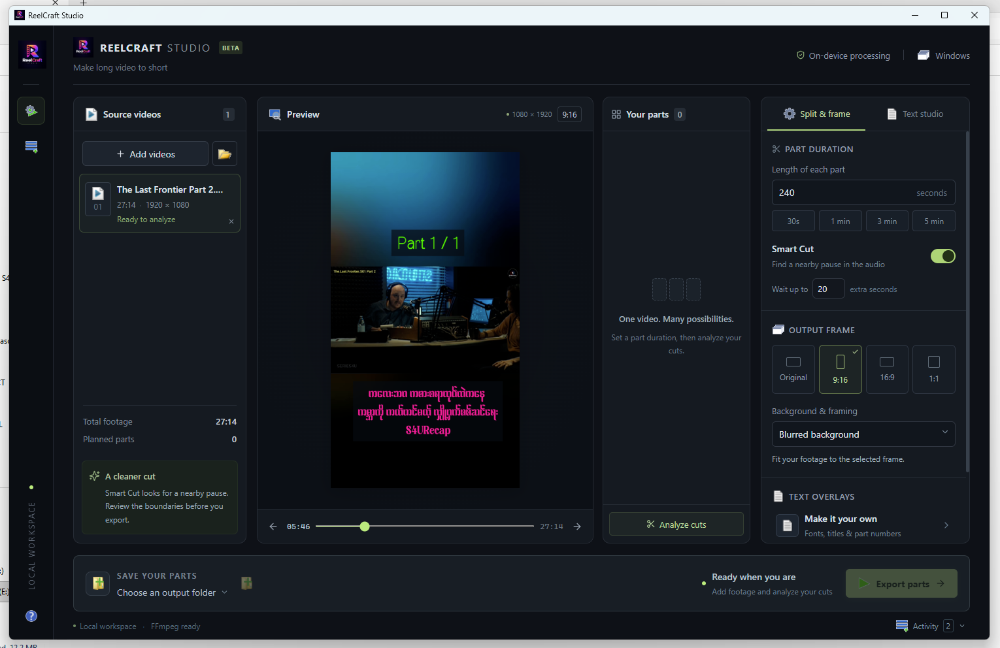

# ReelCraft Studio

[မြန်မာ (မူလ)](README.md) | **English**

**Make long video to short.** A local video splitter built with Rust, Tauri, and React, with a macOS-style desktop interface. Windows is locally validated; GitHub Actions is configured to build Windows, Linux, and macOS.

## 1.0.1 · Build 2 · Beta

- macOS-style window controls, colorful icons, sidebar tagline, and About gear button.
- CPU, GPU, RAM, and OS details in the desktop header; availability varies by platform.
- Auto wallpaper or separate top/bottom wallpapers with zoom, crop positioning, and preview dragging.
- Output Frame controls with 25%–200% video scaling and adjustable video position.
- Fastest, Fast, Balanced, and Quality encoding profiles; NVIDIA NVENC with CPU fallback.
- Dedicated Activity page, local project history, and one UTF-8 title list per source export.

See [the update log](UPDATE_LOG.md) for version history.



## Run the final app

### Windows ready-to-use ZIP — no build required

> [!TIP]
> **🟢 Get the ready-to-use Windows app**
>
> ### [⬇ Download Windows ZIP](https://github.com/isaminnthuaung-ux/ReelCraft-Studio/releases/latest)
>
> 1. **Download** `ReelCraftStudio-1.0.1-Build-2-Windows-x64.zip` (or the matching newer version).
> 2. Choose **Extract All**.
> 3. Open **ReelCraftStudio.exe** inside the extracted folder.
>
> **✓ FFmpeg / ffprobe are included.** No separate media-tool installation, PATH changes, Node.js, or Rust needed.

> [!IMPORTANT]
> **🛡️ Seeing “Windows protected your PC” on first launch?**
>
> ReelCraft Studio is currently **unsigned**, so Windows SmartScreen may display **Unknown publisher / unrecognized app**. That reputation warning alone does not mean a virus has been detected.
>
> If you downloaded the app directly from this project's [GitHub Releases](https://github.com/isaminnthuaung-ux/ReelCraft-Studio/releases) and trust the file, choose **More info → Run anyway**. You can also compare the ZIP's checksum with the release's `SHA256SUMS.txt`.
>
> This is not a guarantee that the app is risk-free. If antivirus reports a specific threat separately, stop and investigate. [Microsoft's SmartScreen explanation](https://learn.microsoft.com/en-us/windows/apps/package-and-deploy/smartscreen-reputation)

> [!NOTE]
> **🔵 If the app cannot open because WebView2 is missing**
>
> Run the included `prerequisites/Install-WebView2.exe` once, then reopen the app. This step **requires an internet connection**.
>
> [Detailed setup and Actions download instructions](docs/WINDOWS-DOWNLOAD.md)

The build commands below are for developers building from source.

| OS | Open the final build |
| --- | --- |
| Windows | Double-click `FinalBuild/Windows/ReelCraftStudio.exe`. |
| Linux | Run `bash FinalBuild/Linux/START.sh`. |
| macOS | Open `FinalBuild/macOS/START.command`, or run `bash FinalBuild/macOS/START.sh`. |

The destination machine needs **FFmpeg and ffprobe** installed and available on PATH. Windows also needs **Microsoft Edge WebView2 Runtime**. Linux needs WebKitGTK runtime libraries. Install and select a Myanmar Unicode font for Myanmar text overlays.

### Build from source

Run only the script for your OS from the project directory. It runs `npm ci` and creates a native release executable.

| Host OS | Command | Output folder |
| --- | --- | --- |
| Windows | `.\BUILD-WINDOWS.bat` | `FinalBuild/Windows/` |
| Linux | `bash BUILD-LINUX.sh` | `FinalBuild/Linux/` |
| macOS | `bash BUILD-MAC.sh` | `FinalBuild/macOS/` |

Install prerequisites first:

- All platforms: Node.js/npm, Rust/Cargo, FFmpeg, and ffprobe.
- Windows: Microsoft C++ Build Tools with Windows SDK, plus Edge WebView2.
- Linux: Tauri 2 development dependencies for your distribution and system fonts.
- macOS: Xcode Command Line Tools (`xcode-select --install`). With Homebrew installed, use `brew install ffmpeg` for media tools.

Ubuntu/Debian dependency example:

```bash
sudo apt update
sudo apt install libwebkit2gtk-4.1-dev build-essential curl wget file libxdo-dev libssl-dev librsvg2-dev libayatana-appindicator3-dev ffmpeg fontconfig fonts-dejavu fonts-noto-core
```

See [Tauri prerequisites](https://v2.tauri.app/start/prerequisites/) for setup. Build each platform on its own OS, for the host CPU architecture. These scripts produce portable executables, not installers, macOS `.app` bundles, or DMGs. Linux/macOS native builds and runtime have not been tested on this Windows machine.


## Workflow

The desktop header shows CPU, graphics adapters, physical RAM capacity, and OS
information. Hover over a shortened value to see the full details. The browser
preview shows placeholders because hardware inventory is read by the desktop app.

The custom macOS-style title bar has close, minimize, and maximize/restore
controls on the left. Drag its empty area to move the window, or double-click
to maximize/restore. Closing during processing requests a safe stop first.

**Output Frame → Video scale** shrinks or zooms the video from 25% to 200%,
including in Original mode. The slider and percentage field stay synchronized;
**Reset** returns to 100%. Output dimensions and text-overlay sizes stay fixed.
Shrinking reveals the selected background; zooming crops the video at the edges.

For image backgrounds, choose an output ratio, then select
**Background & framing → Custom wallpaper**. Import a PNG, JPG, WebP, or BMP
image (up to 32 MB). The app keeps a local copy, automatically scales and crops
it to the chosen output dimensions, and fits the video in front without
stretching it. Preview and export use the same framing. Wallpaper is visible
where the video leaves space around the edges, including when you shrink video
in Original mode.

Wallpaper has two modes: **Auto** fits one image behind the video; **Split**
uses separate top and bottom images. In Split, select an area to choose its
image, zoom from 100% to 300%, and adjust horizontal/vertical crop positions.
You can also drag the selected wallpaper area in Preview or use arrow keys.
**Video vertical position** adjusts the space above and below the video.
Each image is clipped to its own region, and all adjustments are saved with
the project. Until you choose separate images, both regions reuse the Auto
wallpaper. The Output Frame controls are grouped in a light-blue box.

When the Title field contains text, export also writes a UTF-8 `part-titles.txt`
beside each source video's exported parts. It contains one `Part N - Title`
line per successfully exported or reused part, preserving Myanmar text and
original part numbers. Deselected parts are omitted; multiline titles become
one line. The list is updated after each completed part, including on resume.

Use **Activity log** in the sidebar for the current project's processing events.
**Project history** keeps the latest 30 projects in local app storage, including
source paths, cut selections, settings, output folder, and activity. Choose
**Open project** to restore one, or **New project** to start another workspace.
Restoring requires the original video files to remain available. Video files
are referenced in place, not copied into history.

In the **bottom export bar → Encoding profile**, choose **Fastest (P1)**, **Fast (P3)**, **Balanced (P5)**, or **Quality (P7)**. Fastest is the default and prioritizes NVIDIA encoding speed, allowing larger files. Your selection is saved for future sessions. Profiles use NVIDIA NVENC when available; CPU fallback retains the existing `veryfast` H.264 settings. Frame dimensions are selected separately.

The workspace shows Preview and Your parts as side-by-side cards, with a wider preview and a narrow vertically scrolling parts list.

1. Add videos, add a folder, or drag files/folders into the window.
2. Set part length in seconds. Enable Smart Cut to search a bounded extension window for a pause.
3. Select Original, 9:16, 16:9 or 1:1 framing. Non-original ratios support blur, black bars and center crop.
4. In **Text studio**, select the title or part-label layer. Choose from the searchable Windows fonts list (system and current-user installed fonts), or optionally import TTF/OTF/TTC files. Change text, size, color, opacity, background box and position. Drag the text handle in the preview to position it.
5. Analyze cuts and review the parts. Deselect parts you do not want to export.
6. Choose an output folder and export. Open Activity for processing details.
7. Stop safely if needed. Run the same source/settings/output again to reuse verified completed parts.

The app provides frame previews with a seek slider, not real-time playback. Settings and imported fonts persist in the app's private data folder. Project history stores source paths, cut selections, and settings locally; reopen a saved project while its original videos remain available. Matching disk exports remain reusable.

## Fonts and Unicode

Both text preview and export use the same Rust `cosmic-text` shaping/rasterization engine. The overlay is rendered at export resolution, then displayed scaled in the preview. Myanmar complex-script text and mixed Latin names are included in native integration tests.

- Imported fonts are copied into this app's private font library.
- The Windows font picker renders only visible rows and uses Segoe UI for names, avoiding loading every installed font on open. Search and keyboard navigation are supported. The video overlay still renders in the selected font.

- Font coverage varies. The app reports fallback font use and missing glyphs; export refuses unresolved missing-glyph output.
- Family selection is supported in v0.1; separate face/weight selection, stroke/shadow, variable-axis controls and color emoji are not promised in this release.
- Part labels support `{n}`, `{total}` and `{mm}`. Using `{mm}` also formats the total with Myanmar digits.
- The new app does not strip English words or translate narration.

## Output safety

Each source has a path-hash output folder. Each rendered part has a settings/content fingerprint suffix. Changed settings generate new artifacts instead of overwriting earlier exports. A checkpoint records completed outputs, which are probed before reuse. Old exports are never automatically deleted.

Export automatically probes NVIDIA NVENC with a real encode and uses it when available with the selected encoding profile (default: p1, VBR, CQ 18). If hardware initialization or encoding fails, it falls back to CPU H.264 (`libx264`, veryfast, CRF 20). Source audio is encoded as AAC. Processing remains local and sequential. Progress updates during each part, with encoder and speed shown; cancellation interrupts the active analysis/render process. The preview and export share the optimized background-filter path. Completed parts from the earlier release remain reusable when the source and settings match.

Smart Cut uses audio energy, not speech recognition. It cannot guarantee sentence completion. Constant loud audio uses exact cuts; silent audio uses the requested boundary. A final short remainder may merge into the previous part, matching the existing splitter concept.

## GitHub Actions builds

The [desktop build workflow](.github/workflows/windows-portable.yml) runs on pushes to `main`, pull requests targeting `main`, `v*` tags, and manual **Run workflow** requests.

| Platform | Runner / architecture | Download |
| --- | --- | --- |
| Windows | Windows / x64 | ZIP with FFmpeg and ffprobe included |
| Linux | Ubuntu 24.04 / x64 | Native executable `.tar.gz`; install FFmpeg and WebKitGTK 4.1 |
| macOS | macOS 15 / Apple Silicon arm64 | Unsigned native executable `.tar.gz`; install FFmpeg |

Open the repository's **Actions** tab, select a successful run, and download the matching artifact. Extract the artifact and then its included archive. Linux/macOS packages include launch scripts and [setup instructions](docs/UNIX-DOWNLOAD.md); these are native executables, not `.app` bundles or installers. Intel Mac builds are not included.

Version tags publish packages and SHA-256 checksums to GitHub Releases after all platforms succeed. Source changes must be committed and pushed before Actions can build them. Linux/macOS execution still needs validation on those systems.

## Development / Tests

Final build: see the OS-specific scripts above. Development: `npm run tauri -- dev`.

```text
cargo test --manifest-path src-tauri/Cargo.toml -- --test-threads=1
npm run build
npm run test:ui
```

## Current release scope

Windows is the currently validated platform; Linux/macOS validation is pending. No Gemini/Whisper/TTS, social accounts, publishing, or posting quotas. Local project history and encoding profile selection are implemented. Manual cut-boundary editing, advanced typography, and manual encoder selection remain future work. See `PLAN.md` for the broader design.
